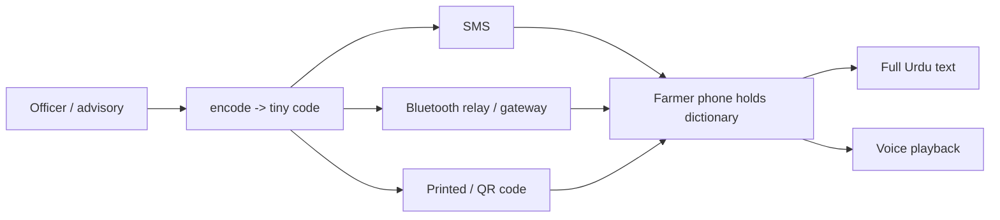

# Kisan Voice

**Offline-first agricultural advisories for low-connectivity farmers in Pakistan.** Advice is
stored in an offline dictionary, so only a tiny code (~9 bytes / one SMS) needs to travel by SMS
or Bluetooth; any phone holding the dictionary expands it into the full message in Urdu — as text
or spoken audio — with no internet.

> **Status: working prototype.** The engine is built and tested. All crop advisories are **drafts
> pending agronomist review** and are not for real farmer use yet. No field pilot has run.

## Try the live demo
If GitHub Pages is enabled (Settings → Pages → Deploy from branch → `main` → `/root`), the demo is
at `https://<your-username>.github.io/<repo>/` — pick a crop, decode a code live, hear it read aloud.

## Architecture


## Built & tested
- Encode/decode engine with JSON-Schema validation, SMS + binary forms, language fallback,
  version-mismatch safety, GSM-7/UCS-2 segment counting, typed template slots — **14 unit tests**.
- **9 crop dictionaries** (Punjab/Sindh/KPK × 3 crops), **367 source-cited draft advisories**.
- Compression benchmark (~93% smaller as a code) and a web demo whose JS is **verified identical
  to the Python on all 367 entries**.
- Village BLE-mesh **simulator** (labelled placeholder range) and a mock SMS trial harness.
- Android relay app (Kotlin) — codec proven, **BLE untested on hardware**.

## In progress / not done
Agronomist approval of advisories · native Sindhi/Pashto/Punjabi translations · real SMS (needs a
SIM) · on-phone mesh hop test · Urdu voice clips · a field pilot.

## Quick start
```bash
pip install -r requirements.txt
python -m kisaan_voice validate --dir dictionaries   # validate all dictionaries
python -m kisaan_voice demo --region punjab --crop cotton
python -m pytest -q                                   # 14 tests
python run_s1.py                                      # mesh simulation + charts
```

## Honesty & safety notes
- Every advisory is `status: draft` — nothing is agronomist-approved; the SMS sender refuses to
  send anything not `approved`.
- **Never commit real farmer phone numbers.** The included `farmers.csv` files are fake test data.
- No pesticide doses are stated anywhere; pest messages defer to the extension officer and label.

## License
MIT — see LICENSE.
